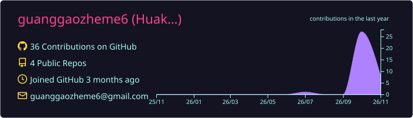
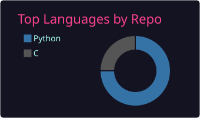
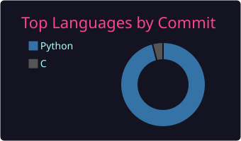

  

  

  

<table>
  <tr>
    <td align="center" valign="middle" width="360">
      
    </td>
    <td align="left" valign="middle">
      <b>Huakun Li</b> 
      Embedded systems · Python / C
        
      <code>now</code>&nbsp;&nbsp;&nbsp;双臂 14 关节伺服 —— STM32H743 · 双 FDCAN · DM 电机 · 400 Hz 
      <code>learn</code>&nbsp;MuJoCo 闭环仿真 · 固件宿主化（stub HAL 编译成 DLL）· C++ 分层架构 
      <code>build</code>&nbsp;双臂下位机 · WORD_QUIZ · washing-text 
      <code>aim</code>&nbsp;&nbsp;&nbsp;仿真里跑通，再上真机
        
      「先把东西跑通，再谈说得好不好听。」
    </td>
  </tr>
</table>

  

 

  <picture>
    <source media="(prefers-color-scheme: dark)" srcset="https://raw.githubusercontent.com/guanggaozheme6/guanggaozheme6/output/snake-dark.svg" />
    <source media="(prefers-color-scheme: light)" srcset="https://raw.githubusercontent.com/guanggaozheme6/guanggaozheme6/output/snake.svg" />
    
  </picture>

 

  

  
  

  

<code>▸ 原图</code>

 

  

